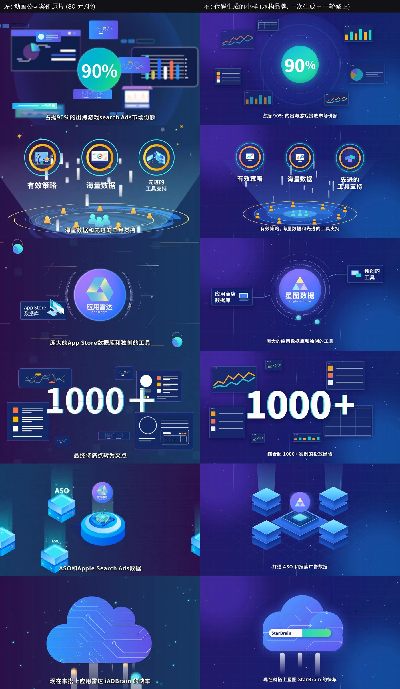
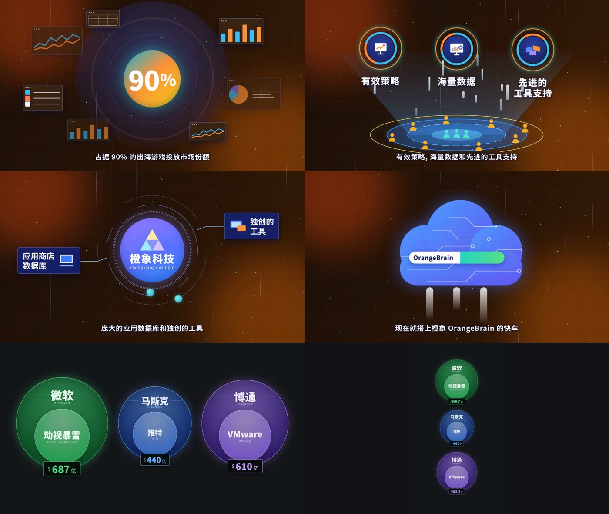

# 可编辑的生成式视频: 市场选择与作战方案

**日期**: 2026-11-12
**标签**: #研究报告 #战略 #视频生成 #Agent #市场选择
**状态**: 整合报告 v1. 结论以本文为准, 取代 002, 003, 004; 005 和 006 保留作工程参考 (范围要按第 6 节调整)

> 摘要: 用模型写代码生成视频, 产出的是一份可以逐项修改的 "视频源文件", 而不是一段抽卡得到的像素. 实测表明这件事在信息类动画上已经可用: 改两个数字重新出片 18 秒, 换一套品牌色 53 秒, 都不需要再调用模型. 最适合打的品类是 "讲解类信息动画", 它同时对应两个市场: 科技企业的宣传和讲解片 (现在就有人按 80-100 元/秒付钱), 以及知识类创作者的动态图形 (频次高, 你们自己就是用户). 打法是先用服务赚钱并积累组件库, 再把内部工具开放给创作者. 编辑器本身不是我们的战场, 那一层已经有人免费在做.

---

## 问题

1. 一家动画公司按 80-100 元/秒卖科技企业宣传动画. 我们用模型写代码做同类内容, 能不能吃掉这块业务?
2. 除了软件发布视频, 能不能给知识类博主 (秋芝, 小Lin说这类) 提供可复用的动态素材, 补上即梦, Seedance 这类抽卡式生成的短板 (成本, 不可修改, 不可复用)?
3. 这是不是一个 Agent 工具或视频编辑软件的机会: 每个场景都能单独编辑, 成本越来越低, 复用率越来越高, 能不能重新定义视频生成和视频编辑?
4. 这个能力最适合打哪个市场, 这一仗怎么打?

**需要你确认的一个数字**: 你在消息里写的是 "8 元/s", 但聊天截图里对方的报价是 "第一个和第三个 80 元每秒, 第二个 100 元每秒". 本文按 80-100 元/秒计算. 如果真的有人按 8 元/秒在卖, 第 5 节里 "服务价差" 的部分就不成立, 请告诉我.

另外, 你提到的 "lovable", 我按 Lovart 这类设计和视频生成 Agent 理解. 如果指的是建站的 Lovable, 它其实和我们是同一条路线: 生成的是可以继续修改的源码, 而不是一张网页截图. "视频界的 Lovable" 反而是个贴切的类比.

## 一页结论

1. **判断成立, 但要分清对手是谁.** 对 80-100 元/秒的人工动画, 成本差两个数量级, 这是真实的价差. 对即梦和 Seedance, 成本差距不大而且在缩小 (Seedance 2.5 在 720p 下约 1.5 元/秒), 真正的差别是 "文字和数字准确" 以及 "改一处不用重来".
2. **"重新定义编辑" 的方向是对的, 而且行业已经在往这个方向走.** HeyGen 在 2026-10 发布了给 Agent 用的开源视频编辑器, Remotion 的编辑器也加了给 Agent 的控制接口, Canva 收购了动效软件公司, 剪映发布了 Agent 助手. 所以 "编辑器" 这一层不该是 3 个人的战场. 我们该占的是它上面的一层: 垂直的组件资产库, 从讲稿到画面的理解, 以及交付.
3. **最适合打的品类是 "讲解类信息动画".** 两个市场共用同一套资产: 科技企业的宣传和讲解片 (预算现成), 知识类创作者的动态图形 (频次高).
4. **打法: 先服务, 后工具.** 服务的价差窗口我判断只有 12-18 个月, 因为同行很快也会用上这些免费工具, 价格会下来. 要用这段时间赚钱, 攒组件库, 攒案例, 再把内部工具开放给创作者.
5. **"可编辑" 和 "可复用" 不是白来的.** 实测中换品牌色时, 我写死在代码里的颜色没有跟着变. 这两件事要靠组件规范做出来, 这正是产品的工作量, 也是壁垒所在.
6. **先花两周做 5 个验证实验** (第 8 节), 每个都有通过线, 再决定投入多少.

---

## 1. 证据: 实测

### 1.1 做了什么

| 小样 | 内容 | 目的 |
|---|---|---|
| 仿宣传片 | 对照动画公司发来的 95 秒案例 (单价 80 元/秒), 用虚构品牌重做其中 6 类镜头, 共 26 秒 | 检验 "能不能吃掉这块业务" |
| 仿创作者素材 | 对照小Lin说视频里的 "收购金额对比" 嵌套圆图, 做成数据驱动的透明背景素材 | 检验 "能不能给博主供素材" |
| 编辑实验 | 改数字, 换品牌, 加一组数据, 换竖屏 | 检验 "场景可单独编辑, 可复用" |

全部由模型一次生成加一轮修正, 没有人工调整. 源码在 [assets/007/probe](assets/007/probe/).



### 1.2 结果

| 项目 | 结果 |
|---|---|
| 代码量 | 运行时 + 7 个组件共 32 KB; 描述这条 26 秒视频的文档只有 1.8 KB. 也就是约 95% 的代码是可以复用的组件, 只有约 5% 属于这一条视频 |
| 首次渲染 | 26 秒成片 (780 帧, 1080p) 用时 52 秒, 4 核机器 |
| 改两个数字 | 只重新渲染受影响的 2 个场景, 用时 18 秒, 不调用模型 |
| 换品牌 (配色 + 名称) | 全片重新渲染 53 秒, 不调用模型 |
| 素材加一组数据 | 版式自动重排, 不调用模型 |
| 素材换竖屏 | 自动改为纵向排列, 不调用模型 |
| 首做的模型成本 (估算) | 按代码量折算, 这 26 秒按 Opus 5.5 价格约 $0.6-0.8, 按 Fable 5.2 价格约 $1.2-1.6. 这是估算, 不是计量值 |
| 同一案例的市场价 | 26 秒 x 80 元 = 2,080 元 |



### 1.3 边界 (如实记录)

- **画面密度不如原片.** 信息类镜头 (数字, 图表, 界面卡片, 标志, 进度条) 结构上已经对齐, 但原片的层次和细节更丰富. 我的判断是达到原片八成左右, 需要动效设计师定标准.
- **插画类镜头没有做.** 原片里的等距办公室, 人物, 建筑, 靠纯代码画不好. 可行的做法是用图像模型生成分层插画素材, 再用代码做动画. 这条管线还没有验证.
- **镜头之间的连续运镜没有做.** 原片是一镜到底式的推拉, 小样是淡入淡出.
- **换品牌时有颜色没跟着变.** 标志底色, 云朵, 图标底盘是我写死的蓝紫色. 说明 "可编辑" 取决于组件是否规范, 不是代码生成自带的属性.
- **竖屏排版是自动的, 但不聪明.** 三组数据纵向堆叠后每组都偏小, 设计师会改成 2+1 布局.
- **透明素材的渲染慢, 文件大.** 6 秒的 ProRes 4444 用了 50 秒, 文件 148 MB; 转成 WebM 后 8.5 秒只有 3.3 MB. 交付格式和并行渲染需要优化.
- **没有配音和音乐.** 这部分不难 (002 的小样做过音效), 但本次没有包含.

## 2. 证据: 钱在哪里

| 对象 | 价格或规模 | 说明 |
|---|---|---|
| 国内科技企业宣传动画 (本次报价) | 80-100 元/秒, 即 4,800-6,000 元/分钟 | 含配音, 角色, 分镜, 动画, 后期, 修改. 对方三条案例对应约 7,600, 12,000, 13,800 元 |
| 国内行情 (二手, 软文性质) | 基础模板级 3,000-8,000 元/分钟; 企业宣传片基础款 1-3 分钟 8,000-30,000 元 | 与上面的报价吻合 |
| 海外讲解视频 | 自由职业者 $1,000-3,000/分钟; 工作室 $3,000-8,000/分钟 | 多家来源区间一致 |
| 抽卡式生成 | Seedance 2.5 API 70 元/百万 token (2026-08-07 上线); 第三方折算 720p 约 1.5 元/秒; 2.0 mini 促销价低至约 0.2 元/秒 | 每改一次都要按秒重新付费, 文字和界面不可控 |
| 代码生成 (本文估算) | 首做含迭代约 0.2-1 元/秒; 组件库成熟后低于 0.1 元/秒 | 改数据和换主题不花模型费用 |
| 创作者工具 (付费意愿的参照) | Submagic 约 $800 万 ARR, 15 人, 付费用户月流失约 15%; OpusClip $1,000-2,000 万; Captions 约 $3,000 万 (估算) | 创作者愿意付费, 但流失高 |
| 相邻品类 (结构化, 可编辑的 AI 产出) | Gamma: $1 亿 ARR, 约 50 人, 估值 $21 亿 (2025-11) | 幻灯片上已经验证 "生成可编辑的结构, 而不是图片" 这条路 |
| 同路线的直接对手 | Hera (YC S25): 种子轮约 $50-200 万, 2026-04 Product Hunt 周榜第一, 第三方估算 2025 年收入约 $33 万 | 品类很早期, 还没有赢家 |

两点解读:

- **价差的来源是人工, 不是算力.** 对人工动画是 50-100 倍的成本差; 对扩散模型只有几倍, 而且对方也在降价. 所以卖点不能是 "比 AI 视频便宜", 而是 "比人工便宜两个数量级, 比抽卡准确, 而且能改".
- **创作者的市场规模和付费意愿, 我没有找到可靠的公开数据.** 知识类创作者数量, 小Lin说和秋芝的制作成本都没有查到. 这部分只能用你们自己的 20 万粉丝去测 (第 8 节实验 E3).

## 3. 这是不是 "重新定义视频生成和编辑"

### 3.1 成立的部分

| | 抽卡式生成 (即梦, Seedance 等) | 结构化生成 (代码) |
|---|---|---|
| 产出物 | 像素 | 源文件: 场景, 组件, 参数, 时间轴 |
| 修改 | 重新生成, 结果不确定 | 改参数, 结果确定 |
| 修改的成本 | 每次按秒付费 | 改数据和主题为零; 用自然语言改约几分钱 |
| 复用 | 基本不能 | 组件, 模板, 品牌套件都能复用 |
| 成本曲线 | 随模型降价而降 | 随模型降价而降, 还随组件库的积累而降 |
| 多画幅, 多语言 | 每个版本重新生成 | 同一份源文件多次输出 |

你说的 "每一帧都可以被编辑", 更准确的说法是 "每个元素在每个时刻都可以被编辑". 帧是算出来的结果, 被编辑的是源文件. 这比逐帧编辑更强: 改一处, 所有帧, 所有画幅, 所有语言版本一起变.

成本持续下降也有依据: Opus 5 到 5.5, Fable 5.1 到 5.2, 各降价 20%; 实测里约 95% 的代码是可复用的组件.

### 3.2 需要修正的三点

1. **只对 "设计出来的画面" 成立.** 文字, 数字, 图表, 界面, 图形, 示意图适用. 真人, 实拍, 写实场景仍然是像素, 只能作为一个不可拆的图层放进来.
2. **可编辑性要靠规范, 不是自带的.** 如果模型每次自由发挥写一堆一次性的代码, 修改就只能再找模型, 既花钱又可能改坏别处. 必须有 "组件 + 参数 + 主题变量" 的约束 (实测 1.3 的教训).
3. **看不到运动.** 模型只能看静帧来检查, 转场和节奏的问题要靠抽帧和规则检查发现. 质量上限由自动质检加人工审美决定.

### 3.3 已经有谁在做

| 玩家 | 做法 | 对我们的含义 |
|---|---|---|
| HeyGen HyperFrames | 开源 (Apache-2.0) 的 HTML 视频框架; 2026-10-05 发布桌面版 Studio, 定位 "第一个为 Agent 做的视频编辑器", 人和 Agent 改同一份工程文件 (二手报道) | 编辑器层有免费的, 而且背后是一家年化收入过亿美元的公司 |
| Remotion | React 视频框架; 编辑器支持画布拖拽, 关键帧, 以及给 Agent 的控制工具 | 同上; 3 人以上公司要付授权费 |
| Anthropic Claude Design | 对话生成动画, 目前没有原生的 MP4 导出, 已有多款第三方导出工具 | 模型厂商随时可能补上导出, 基础能力会进入每个聊天窗口 |
| Hera | "代码生成的动画, 每个参数都能用对话或画布修改" | 同定位的创业公司, 很早期 |
| Canva | 2026-02 收购动效软件 Cavalry; 2026-04 发布 Canva AI 2.0 | 巨头在补动效能力 |
| 剪映 | 2026-09-20 发布剪映 Hub, AI 助手小映, 剪映助手 (含视频包装), 强调产出 "可继续修改的初版" | 巨头也在讲 "可编辑"; 暂未见针对图表和信息图动效的专门功能 |
| ChatCut, Vizard 等 | 上线了 AI 动态图形功能 | 功能层面的竞争者 |
| 国内开源 | SeeCut (口播转动效再转剪映草稿), 歸藏的 skill 等 | 免费替代品 |

### 3.4 所以我们占哪一层

```
模型层        Anthropic 等             -> 用, 不碰
编辑器和格式层  HyperFrames, Remotion, 剪映, Canva  -> 兼容, 不自研
垂直资产和工作流层  组件库 + 讲稿理解 + 交付 + 分发   -> 我们的位置
```

"可编辑的生成式视频" 是产品故事和品牌叙事, 可以大声讲. 但要赢的那一仗是一个垂直品类, 靠的是三样别人短期抄不走的东西: 一套越用越厚的讲解图形组件库, 把讲稿变成合适画面的判断力, 以及你们自己的内容渠道.

## 4. 市场选择

### 4.1 代码视频的甜区: 四个条件

1. 信息密度高: 画面的主体是数字, 文字, 结构, 关系.
2. 经常要改: 版本多, 数据会变, 客户会提修改, 要多语言.
3. 风格可以系统化: 有品牌规范或固定的频道风格.
4. 不依赖真人和实拍.

### 4.2 候选市场评分 (5 分制)

| 市场 | 现成预算 | 频次 | 甜区契合 | 团队优势 | 竞争 | 到手现金的速度 | 结论 |
|---|---|---|---|---|---|---|---|
| A 科技企业宣传和讲解动画 (含软件发布视频) | 5 | 2 | 4 | 4 (粉丝里有大量 AI 和科技团队) | 3 (对手是人工作坊) | 5 | **第一阶段主攻** |
| B 知识类创作者的动态图形 | 2 | 5 | 5 | 5 (自己就是创作者, 有渠道) | 2 (剪映, 开源, 多个工具) | 2 | **第二阶段主攻** |
| C 给广告公司和动画工作室供货 (白牌) | 4 | 4 | 4 | 2 | 3 | 4 | 作为 A 的渠道战术 |
| D 政务, 医疗科普动画 | 5 | 3 | 4 | 1 (靠招投标和关系) | 2 | 1 | 只通过 C 间接做 |
| E 课程和培训讲解 | 3 | 4 | 5 | 3 | 3 | 2 | 第三阶段扩展 |
| F 通用视频编辑器 | - | - | - | 1 | 1 | - | 不做 |
| G 短剧, 娱乐, 实拍类 | - | - | 1 | - | - | - | 不做 |

之前文档里的 "软件发布视频" 并入 A, 作为其中一个子类, 不再单独作为主线.

### 4.3 为什么是 A 和 B 一起

- 它们用的是同一套组件: 数据对比, 流程, 时间线, 架构图, 界面演示, 标题动画. 给企业做一条片子攒下的组件, 就是创作者工具的库存.
- A 解决 "现在的钱", B 解决 "以后的规模". 只做 A 是一家动画工作室; 只做 B 要先熬过没有收入的产品期.
- B 的最好广告是你们自己的视频. 每一期用自己的工具做图形, 观众问 "这是怎么做的", 就是获客.

## 5. 作战方案

### 5.1 定位

对企业: "48 小时交付, 半价, 数字和文案随时改" 的讲解动画.
对创作者: "把讲稿变成可以改的动态图形", 导出后直接拖进剪映.
对外的故事: 可编辑的生成式视频.

### 5.2 三个阶段

| 阶段 | 时间 | 做什么 | 目标 (是目标, 不是预测) |
|---|---|---|---|
| 0 样板间 | 2 周 | 第 8 节的 5 个验证实验; 把小样补成一条 90 秒带配音的完整成片; 组件库 v0 约 30 个 | 实验过线 |
| 1 以战养战 | 第 1-3 个月 | 卖服务: 科技企业宣传和讲解片. 渠道: 粉丝私域, 案例内容, 3-5 家白牌合作方. 自己的每期视频都用自家图形 | 第 3 个月服务月流水 >= 8 万元; 组件库 >= 60 个; 单条人工时间降到首条的 1/3 |
| 2 开放工具 | 第 3-6 个月 | 把内部工具开放给知识类创作者: 讲稿或口播 -> 推荐图形 -> 可修改 -> 导出透明素材或剪映草稿. 从粉丝里招 100 人内测 | 内测周活 >= 40%; 付费 >= 30 人; 第 6 个月新业务合计 >= 15 万元/月 |
| 3 自助工作室 | 第 6-12 个月 | 整条讲解视频的自助生成 (视频版的 Gamma); 英文版; 模板市场 | 第 12 个月 >= 30 万元/月, 其中产品收入占比 >= 40% |

国内先起量 (粉丝, 渠道, 案例都在国内), 产品从第一天做中英双语. 海外用英文服务页和创作者工具英文版切入, 由海外团队负责.

### 5.3 定价和单位经济 (假设, 待验证)

**服务 (国内)**

| 档位 | 价格 | 说明 |
|---|---|---|
| 标准 | 49 元/秒 | 基于组件库, 48 小时初稿, 改数字和配色不限次 |
| 定制 | 69 元/秒 | 含定制插画和镜头设计 |
| 白牌供货 | 25-30 元/秒 | 给广告公司和动画工作室, 走量 |

海外沿用 004 的三档 ($299 / $799 / $1,999).

一条 90 秒标准片: 收入约 4,400 元. 成本: 模型 10-110 元 (有库到无库), 配音和授权摊销约 30-70 元, 人工 4-8 小时. 一个人全职约可交付每月 20 条. 人工时间是关键变量, 实验 E4 专门测它.

**创作者工具**: 国内 69-99 元/月, 海外 $19-39/月, 按素材数计量. 库内组件换数据的模型成本是几分钱级别; 新做一个组件约几元. 毛利估算 70% 以上.

### 5.4 三个必须赢的点

1. **质量线**: 一条 90 秒成片, 让潜在客户盲选, 不输 80 元/秒的供应商.
2. **复用线**: 第 10 条片子的人工时间不超过第 1 条的 1/3.
3. **分发线**: 自己的内容每周都用自家工具, 并且能带来询单和内测报名.

### 5.5 分工

| 角色 | 负责 |
|---|---|
| 工程 | 组件规范, 文档格式, 渲染和导出, 自动质检 |
| 设计和内容 | 组件库的审美标准, 交付精修, 自己频道的图形 |
| 增长和业务 | 服务销售, 白牌合作, 创作者内测社群 |
| 海外团队 | 英文服务页, 海外客户, YouTube 创作者触达 |

存量业务仍然是跑道, 沿用 004 的底线: 月流水不低于 5 万元.

### 5.6 止损线

- 盲测少于 3/10 认可: 先不卖服务, 补插画管线和动效, 4 周后重测.
- 第 3 个月服务月流水低于 3 万元, 且询单少于 10 个: 停掉服务线, 只保留创作者工具实验.
- 内测周活低于 20%, 或者没人把素材用进正片: 工具形态不对, 改为 "模板包 + 代做".
- 剪映, Canva 或 HeyGen 上线同等质量且免费的 "讲稿转图表动效": 收缩到服务加一个垂直模板库 (例如财经或 AI 科普).

## 6. 产品和技术上的变化 (相对 005, 006)

1. **工程文件格式对齐 HyperFrames**, 让我们的工程能在它的编辑器里打开. 不自研编辑器.
2. **组件只能引用主题变量.** 加一条自动检查: 换一套主题后截图比对, 发现写死的颜色就报错.
3. **新增导出**: 透明背景素材 (WebM 和 MOV, 另备绿幕 MP4 兜底), 剪映草稿 (参考开源的 SeeCut), 按场景缓存渲染 (实测已实现). 剪映对透明视频的支持情况需要实测确认.
4. **新增输入**: 讲稿或口播音频 -> 分段 -> 推荐图形 -> 按语音时间对齐.
5. **新增插画素材管线**: 图像模型生成分层素材, 代码做动画. 用于等距场景和人物.
6. **模板范围**: 从 "10 个发布视频模板" 改为 "40-60 个讲解图形组件 + 3 套成片风格".
7. **模型分层**: 新做组件用最强的模型 (Fable 5.2 为 $8 / $40 每百万 token, Opus 5.5 为 $4 / $20); 库内换数据和小修改用 Sonnet 5.5 ($2 / $10) 或 Haiku 5.5 ($0.10 / $0.50).

006 的整体架构 (文档格式, 组件, 编译, 渲染, 质检, 作业流水线) 不变. 005 的需求文档需要按上面的范围改一版.

## 7. 风险

| 风险 | 应对 |
|---|---|
| 同行也用上免费工具, 服务价格下跌 | 把服务当成有期限的窗口, 用它攒库和案例; 第 3 个月起投入工具 |
| 平台和模型厂商把基础能力做成免费功能 | 不在编辑器层竞争; 壁垒放在垂直组件库, 讲稿理解, 自有渠道 |
| 掉进服务陷阱, 团队被订单占满 | 设服务产能上限; 每单必须沉淀至少 1 个新组件; 第 6 个月起考核产品收入占比 |
| 审美不够, 做出来 "AI 味" 重 | 设计负责人定组件标准; 盲测作为上线门槛 |
| 创作者付费低, 流失高 | 优先卖给 MCN 和工作室; 按素材量计费; 用 "频道风格包" 提高迁移成本 |
| 插画和人物镜头做不好 | 插画管线单独验证; 报价时区分 "信息类" 和 "插画类" 镜头 |
| 素材的版权 (品牌标志, 字体, 音乐) | 客户授权条款; 只用可商用的字体和曲库 |

## 8. 接下来两周: 5 个验证实验

| 编号 | 实验 | 通过线 |
|---|---|---|
| E1 盲测 | 把小样补成 90 秒带配音的完整成片, 和供应商案例一起给 10 个潜在客户盲选 | >= 5 人认为不输 |
| E2 报价测试 | 在粉丝群和朋友圈发布 "48 小时, 49 元/秒" 的服务页 | 两周内 >= 3 单付定金 |
| E3 创作者测试 | 给 10 个知识类博主按他们的讲稿各免费做 5 个素材 | >= 6 人用进正片, >= 3 人表示愿意按月付费 |
| E4 复用测试 | 连续做 5 条同品类片子, 记录每条的模型花费和人工时间 | 第 5 条不超过第 1 条的 40% |
| E5 白牌询价 | 问 2-3 家动画或广告公司是否愿意按 25-30 元/秒采购 (可以从这次找上门的那家问起) | >= 1 家愿意试单 |

还需要你补充的信息: 20 万粉丝里, 知识类创作者和科技公司从业者大约各占多少; 存量业务的类型; 能投入的设计人力.

## 与旧文档的关系

| 文档 | 状态 |
|---|---|
| 002 软件 Demo 视频生成 Agent | 归档. 能力实测和竞品调研已并入本文第 1-3 节 |
| 003 代码视频引擎产品与技术规划 | 归档. 多场景规划被本文第 4 节的市场选择取代 |
| 004 全球化产品规划与执行 | 归档. 路线图被本文第 5 节取代; 海外服务定价沿用 |
| 005 产品需求文档, 006 技术设计文档 | 保留作工程参考, 范围按本文第 6 节调整 |

## 参考来源

> 调研时间 2026-11-12. 除注明外均为二手来源, 数字之间有冲突, 引用前请核对原始出处.

- 实测: 本仓库 [assets/007/probe](assets/007/probe/); 供应商报价来自你提供的聊天截图 (一手).
- 模型价格: Anthropic 官方模型价格表 (2026-11-03 缓存版本).
- 国内动画和宣传片报价: [中华网商业快讯](https://m.tech.china.com/redian/2026/0324/032026_1831769.html), [网易号](https://www.163.com/dy/article/KUT6F2LT0556IPQP.html), [中华网投资](https://mtz.china.com/touzi/2026/0729/253466.html)
- 海外讲解视频价格: [Vidico](https://vidico.com/news/how-much-does-an-explainer-video-cost/), [Moonb](https://www.moonb.io/blog/how-much-does-animation-cost), [Maverick Frame](https://maverickframe.com/blog/explainer-video-cost/), [BizToolkit](https://www.biztoolkit.co/post/motion-designer-rates-in-2026-per-hour-per-project-retainer-pricing)
- Seedance 2.5 价格: [凤凰网科技](https://tech.ifeng.com/c/8vOaWTboGWf), [CSDN](https://www.csdn.net/article/2026-08-07/163569140), [ai-indeed 折算](https://www.ai-indeed.com/encyclopedia/29280.html)
- 创作者工具收入: [人人都是产品经理: Submagic](https://www.woshipm.com/operate/6478955.html), [Latka: Submagic](https://getlatka.com/companies/submagic.co), [Sacra: OpusClip](https://sacra.com/c/opusclip/), [Captions 拆解](https://www.openaitoolshub.org/ai-product-research/captions-ai)
- Gamma: [BusinessWire](https://secure.businesswire.com/news/home/20251110805751/en/Gamma-Surpasses-%24100M-ARR-Raises-at-%242.1B-Valuation-as-It-Replaces-PowerPoint-for-the-AI-Era), [The Next Web](https://thenextweb.com/news/gamma-grant-lee-profitable-ai-startup), [Sacra: Gamma vs Anthropic](https://sacra.com/research/gamma-vs-anthropic/)
- Hera: [Extruct](https://www.extruct.ai/hub/hera-video-funding/), [Latka](https://getlatka.com/companies/hera.video), [Product Hunt 观察](https://thehuman2ai.com/design/radar/producthunt-hera-ai-motion-designer)
- HyperFrames 和 Studio: [GitHub](https://github.com/heygen-com/hyperframes), [Product Hunt](https://www.producthunt.com/p/heygen/hyperframes-studio-desktop), [Runtime Wire](https://runtimewire.com/article/heygen-hyperframes-studio-agent-video-editor)
- Remotion Studio: [Hermes AI](https://hermes-ai.net/news/remotion-studio-lets-ai-agents-control-video-editing-without-clicking-buttons/), [2026 更新追踪](https://autoae.online/blog/remotion-updates-2026)
- Claude Design 导出视频: [claude-video-export](https://github.com/dawoodtrumboo/claude-video-export), [Claude2Video](https://claude2video.com/blog/can-you-export-claude-design-videos), [Maybe Labs](https://maybelabs.ai/blog/claude-motion-graphics)
- 剪映 2026-09 发布: [新华网](https://www.news.cn/tech/20260921/6742f6c1f32f41d4918105bc686fe907/c.html), [科技日报](https://www.stdaily.com/web/gdxw/2026-09/20/content_584720.html)
- Canva: [Wikipedia](https://en.wikipedia.org/wiki/Canva)
- 其他工具: [ChatCut 动态图形](https://chatcut.io/zh/features/ai-motion-graphics), [Vizard](https://vizard.ai/cn/tools/ai-motion-graphics-generator), [可编辑时间轴的视频 Agent 盘点](https://motionbox.io/blog/agent-that-edits-video-2026)
